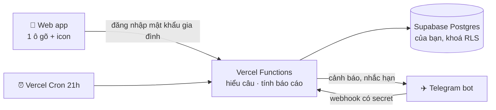

# 💰 Family Budget VN — Thu chi gia đình

> **Cả nhà cùng ghi chi tiêu — gõ 1 dòng là xong, đồng bộ tức thì, cá nhân hoá theo nhà bạn, và hoàn toàn riêng tư.**
>
> *A private, self-hosted family budget tracker for Vietnamese households. Log expenses in plain Vietnamese ("chi ăn sáng 50k") from a web app or a Telegram bot — both write to the same database you own.*

```
Bố đổ xăng, nhắn bot:  "chi xăng 100k"              ─┐
Mẹ đi chợ, mở app gõ:   "chi đi chợ 350k"            ─┼─►  1 sổ chung  ─►  báo cáo · cảnh báo · theo dõi nợ
Hôm qua quên ghi:       "hôm qua chi sữa bỉm 450k #bé" ─┘
```

---

## Vì sao làm tool này?

Các app quản lý chi tiêu thường **cho 1 người**, **nhập lâu** (chọn ví → danh mục → số tiền → ngày…), và **dữ liệu nằm trên máy chủ của người khác**. Gia đình thì cần ngược lại:

| | Family Budget VN |
|---|---|
| 👨‍👩‍👧 **Cả nhà ghi chung, đồng bộ** | Vợ chồng (và ai bạn cho phép) cùng ghi vào **1 sổ duy nhất**. Ai ghi gì, lúc nào, đều thấy ngay. Báo cáo tách theo từng người. |
| ⚡ **2 cách ghi, tiện như nhắn tin** | **Web app** (cài lên màn hình điện thoại như app thật) **hoặc Telegram bot**. Cùng 1 cú pháp tiếng Việt tự nhiên: `[ngày] Thu/Chi + nội dung + số tiền`. Tự hiểu `50k`, `1tr2`, `1.500.000`, `hôm qua`, `15/3`. |
| 🎯 **Cá nhân hoá theo nhà bạn** | Danh mục, **từ khoá tự nhận**, icon, ngân sách tháng/năm, thành viên, khoản nợ, tài sản — sửa như bảng tính. Bot **tự học** từ khoá mỗi lần bạn sửa danh mục. |
| 🔒 **Hoàn toàn riêng tư** | Bạn **tự host** trên tài khoản Vercel + Supabase **của chính bạn** (gói miễn phí). Không có máy chủ trung gian, không quảng cáo, không bên thứ ba đọc dữ liệu. Database khoá RLS, chỉ máy chủ của bạn truy cập được; app có mật khẩu gia đình. |

## Tính năng

- **Ghi nhanh** trên web (1 ô gõ + lưới icon danh mục) và Telegram (gửi nhiều dòng 1 lúc, nút 🗑 Xoá / 📂 Đổi danh mục).
- **6 loại giao dịch**: Chi · Thu · Trả nợ (tách gốc/lãi) · Vay · Cho vay · Thu hồi nợ.
- **Ngân sách**: theo tháng, ghi đè riêng 1 tháng (VD tháng Tết), và **ngân sách năm** cho khoản đóng 1 lần (bảo hiểm, du lịch).
- **Báo cáo tháng**: thực chi vs ngân sách, **so với trung bình 3 tháng trước**, so với tháng trước, **dự phóng cuối tháng** thông minh (không thổi phồng các khoản trả đầu tháng), theo người, theo nguồn thu, biểu đồ 12 tháng.
- **Báo cáo năm**: bảng danh mục × tháng (tô màu ô vượt ngân sách), tổng thu/chi/trả nợ, dư nợ đầu → cuối năm.
- **Theo dõi nợ**: dư nợ từng khoản, tiến độ trả, dự kiến ngày hết nợ, lãi phát sinh, gợi ý trả khoản lãi cao trước (Avalanche), **lịch trả lãi theo năm** (tự nhắc trước hạn, tự chuyển kỳ khi đã trả).
- **Tài sản ròng**: nhà, vàng (số chỉ × giá), tiết kiệm, khoản cho vay → tài sản ròng = tài sản − nợ.
- **Tự động 21h mỗi ngày** qua Telegram: cảnh báo danh mục chạm 80% / vượt ngân sách, nhắc nếu cả ngày chưa ai ghi, nhắc hạn trả lãi, ngày 1 gửi tổng kết tháng trước.
- **Lệnh bot**: `/bc` báo cáo tháng · `/ns` ngân sách · `/no` nợ & tài sản · `/hom` hôm nay · `/xoa` xoá khoản vừa ghi · `/dm` danh mục.

## Cú pháp ghi

`[ngày] Thu/Chi + nội dung + số tiền` — bỏ ngày = hôm nay, bỏ Thu/Chi = Chi.

| Gõ | App hiểu |
|---|---|
| `chi ăn sáng 50k` | Chi 50.000đ · 🍜 Ăn ngoài · hôm nay |
| `15/3 chi đi chợ 350k` | Chi 350.000đ · 🛒 Đi chợ · ngày 15/3 |
| `thu lương 25tr` | Thu 25.000.000đ · 💼 Lương |
| `hôm qua chi xăng 100k #mẹ` | Chi 100.000đ · 🛵 Đi lại · hôm qua · ghi cho **Mẹ** |
| `chi sữa bỉm 450k #bé` | Chi 450.000đ · 👶 Con cái · ghi cho **Bé** |
| `trả nợ ngân hàng 10tr` / `trả lãi ngân hàng 4tr` | Trả nợ (gốc / lãi) · khoản "Vay mua nhà (ngân hàng)" |
| `chi bảo hiểm 10tr` | Khoản theo năm — so với ngân sách năm, không làm "vỡ" ngân sách tháng |

Số tiền: `50k` · `1tr2` (=1,2 triệu) · `2,5tr` · `1.500.000` · `15 triệu`. Danh mục tự nhận theo **từ khoá** (không phân biệt dấu).

## Cách hoạt động (tóm tắt)



Đọc bản giải thích dễ hiểu, kèm ví dụ một ngày của gia đình: **[docs/HOW-IT-WORKS.md](docs/HOW-IT-WORKS.md)**.

## Cài đặt (≈ 30 phút, 0 đồng)

Cần: tài khoản **GitHub**, **Supabase**, **Vercel** (đều miễn phí) và **Telegram**. Không cần biết lập trình — làm theo từng bước.

1. **Fork** repo này về GitHub của bạn.
2. **Supabase**: tạo project → SQL Editor → chạy [`supabase/schema.sql`](supabase/schema.sql) rồi [`supabase/seed.sql`](supabase/seed.sql) (dữ liệu ví dụ, sửa lại sau).
3. **Telegram**: nhắn [@BotFather](https://t.me/BotFather) `/newbot` → lấy token.
4. **Vercel**: *Add New → Project* → import repo vừa fork → thêm 7 biến môi trường → Deploy.
5. Mở app → tab ⚙️ → **Kết nối Telegram** → mỗi người nhắn `/id` cho bot, dán ID vào bảng `members`.

👉 Hướng dẫn chi tiết từng màn hình, kèm xử lý lỗi: **[docs/SETUP.md](docs/SETUP.md)**
👉 Đổi danh mục, ngân sách, thành viên, tên app, giờ nhắc…: **[docs/CUSTOMIZE.md](docs/CUSTOMIZE.md)**

## Chạy thử ngay trên máy (1 phút)

Không cần Supabase hay Telegram — dùng dữ liệu mẫu trong bộ nhớ:

```bash
git clone https://github.com/<bạn>/family-budget-vn.git
```

```bash
cd family-budget-vn && npm run dev
```

Mở http://localhost:3000, mật khẩu **`demo`**. Có sẵn 3 tháng giao dịch mẫu của gia đình "Bố, Mẹ, Bé" để xem báo cáo. Chạy bộ kiểm tra tự động: `npm test` (gần 40 bài kiểm tra, không cần mạng).

## Chi phí & giới hạn gói miễn phí

| Dịch vụ | Gói | Đủ cho gia đình? |
|---|---|---|
| Vercel Hobby | 0đ | ✅ Thoải mái. Cron 1 lần/ngày (có thể lệch trong vòng 1 giờ). |
| Supabase Free | 0đ | ✅ 500 MB ≈ hàng trăm nghìn giao dịch. Project tạm dừng nếu 7 ngày không hoạt động — cron hằng ngày giữ nó luôn chạy. Không có bản sao lưu tải về → nên export CSV hằng tháng. |
| Telegram Bot | 0đ | ✅ |

## Cấu trúc code

```
public/              Giao diện tĩnh (HTML/CSS/JS thuần, không build), manifest để cài như app
  js/shared.js       Dùng chung trình duyệt + máy chủ: hằng số, giờ VN, BỘ HIỂU CÂU NHẬP
api/                 Vercel Functions: app (thao tác web) · login · telegram (webhook) · cron
lib/
  report.js          Báo cáo tháng/năm, ngân sách, baseline, dự phóng, nợ, lãi năm, tài sản ròng
  bot.js, texts.js   Telegram bot + việc chạy hằng ngày
  db.js              Supabase (chạy thật) hoặc bộ nhớ (chạy thử)
  auth.js            Mật khẩu gia đình, cookie ký HMAC 180 ngày, khoá 15' sau 10 lần sai
  seed.js            Dữ liệu ví dụ (sửa cho nhà bạn) · demo-data.js: giao dịch mẫu cho chế độ xem thử
supabase/            schema.sql (bảng + RLS) · seed.sql (sinh từ lib/seed.js: npm run seed-sql)
scripts/             dev-server · test · gen-seed-sql · add-secrets.ps1
```

Không framework, 1 dependency (`@supabase/supabase-js`). Toàn bộ logic là JavaScript thuần, dễ đọc, dễ sửa.

## Bảo mật & riêng tư

- Dữ liệu chỉ nằm trong **Supabase của bạn**. Trình duyệt **không bao giờ** truy cập thẳng database: mọi bảng bật RLS không có policy, chỉ máy chủ (giữ `service_role` key trong biến môi trường Vercel) đọc/ghi được.
- Vào app cần **mật khẩu gia đình** (≥ 10 ký tự trên Vercel). Cookie HttpOnly ký HMAC, sai 10 lần → khoá 15 phút. Muốn đăng xuất mọi thiết bị: đổi `SESSION_SECRET`.
- Bot chỉ phục vụ Telegram ID có trong bảng `members`; webhook xác thực bằng secret token chính thức của Telegram; cron xác thực bằng `CRON_SECRET`.
- Trang gắn `noindex` — không xuất hiện trên Google.

## Câu hỏi thường gặp

**Dùng cho 1 người hoặc 3–4 người được không?** Được. Thêm/bớt dòng trong bảng `members`; ai có ID Telegram trong đó là dùng được bot.

**Có dùng ngoài Việt Nam / tiền khác được không?** Bộ hiểu câu và giao diện viết cho tiếng Việt và đồng (VND). Múi giờ đổi ở `TZ` trong `public/js/shared.js`.

**Có nhập từ sao kê ngân hàng không?** Chưa. Mục tiêu là ghi tay thật nhanh để cả nhà *ý thức* chi tiêu. Pull request chào đón!

**Không dùng Telegram được không?** Được — chỉ dùng web app. Bỏ trống `TELEGRAM_TOKEN`, phần nhắc tự động sẽ tắt.

## Đóng góp

Issue và pull request đều chào đón. Trước khi gửi PR: `npm test` phải xanh. Giữ tinh thần **không framework, ít dependency, dữ liệu thuộc về người dùng**.

## Giấy phép

[MIT](LICENSE) — dùng, sửa, chia sẻ tự do.
