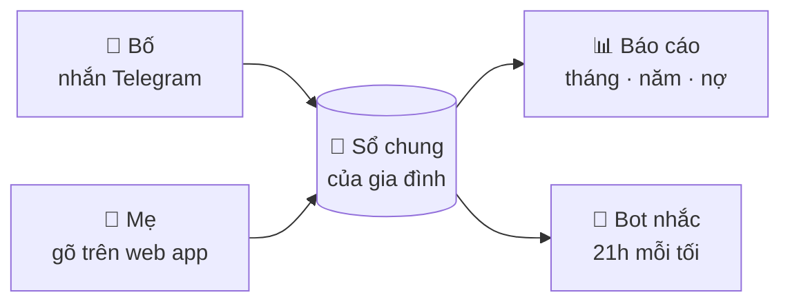
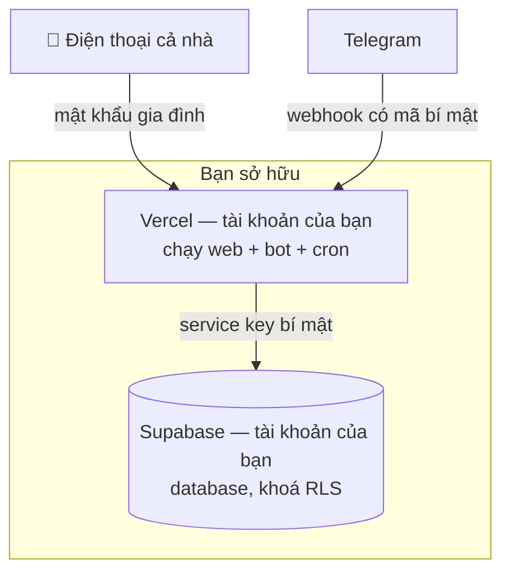

# Family Budget VN hoạt động thế nào?

*Bản giải thích cho người không làm kỹ thuật. Đọc 5 phút là hiểu toàn bộ.*

---

## 1. Ý tưởng chính: một cuốn sổ chung, nhiều cây bút

Hãy tưởng tượng gia đình bạn có **một cuốn sổ thu chi đặt giữa nhà**. Ai tiêu gì thì ghi vào đó. Cuối tháng, cả nhà mở sổ ra xem: tiền đi đâu, có vượt kế hoạch không, nợ còn bao nhiêu.

Family Budget VN chính là cuốn sổ đó, nhưng:

- **Nằm trên mạng** — bố ở công ty, mẹ ở chợ, đều ghi được ngay lúc tiêu.
- **Có 2 "cây bút"**: một **web app** trên điện thoại và một **Telegram bot**. Viết bằng cây nào thì cũng vào cùng một sổ.
- **Tự cộng trừ, tự nhắc** — không ai phải ngồi tính.
- **Sổ là của riêng nhà bạn** — cất trong "két" (database) do chính bạn sở hữu.



---

## 2. Một ngày của gia đình "Bố, Mẹ, Bé"

**07:30** — Bố đổ xăng, mở Telegram nhắn cho bot:

```
chi xăng 100k
```

Bot trả lời ngay:

```
💸 Chi 100.000đ
📂 Đi lại · 👤 Bố · 📅 15/03
🟢 Đi lại tháng này: 650k / 1,2tr (54%)
[🗑 Xoá] [📂 Đổi danh mục]
```

Bot tự hiểu "xăng" thuộc danh mục **Đi lại** nhờ *từ khoá*, tự biết người nhắn là **Bố**, và cho biết luôn danh mục này đã dùng bao nhiêu ngân sách tháng.

**10:15** — Mẹ đi chợ, mở app trên màn hình chính điện thoại, gõ vào **một ô duy nhất**:

```
chi đi chợ 350k
```

Ngay khi gõ, app hiện: *Chi · 350.000đ · Hôm nay · Mẹ · 🛒 Đi chợ (✨ tự nhận)* và dòng nhỏ "Tháng này Đi chợ: 4,8tr → **5,15tr** / 5,5tr (94%)". Mẹ nhấn **Enter** là xong.

**12:00** — Mẹ mua sữa cho bé: `chi sữa bỉm 450k #bé` — dấu `#bé` nghĩa là ghi khoản này cho **Bé** để cuối tháng biết con tiêu bao nhiêu.

**Tối** — Bố nhớ ra hôm qua quên ghi tiền ăn: `hôm qua chi ăn tối 300k`. App ghi đúng vào ngày hôm qua.

**21:00** — Bot tự gửi cho cả hai:

```
⚠️ Cảnh báo ngân sách tháng 03/2027
🟡 Đi chợ & ăn ở nhà: 5,15tr/5,5tr (94%)
🔴 Mua sắm: 1,4tr/1,2tr (117%)
```

**Ngày 1 tháng sau** — bot gửi **tổng kết tháng**: thu, chi, trả nợ, so với trung bình 3 tháng trước, danh mục vượt ngân sách, tổng dư nợ, tài sản ròng.

---

## 3. App "hiểu" câu bạn gõ như thế nào?

Mỗi câu được tách thành từng phần theo mẫu **`[ngày] Thu/Chi + nội dung + số tiền`**:

| Phần | Ví dụ | App làm gì |
|---|---|---|
| **Ngày** (tuỳ chọn) | `15/3`, `hôm qua`, `hôm kia` | Không ghi = hôm nay |
| **Loại** (tuỳ chọn) | `chi`, `thu`, `trả nợ`, `trả lãi`, `vay`, `cho vay`, `thu hồi` | Không ghi = Chi (trừ khi nội dung là "lương", "thưởng"… thì tự hiểu là Thu) |
| **Số tiền** | `50k`, `1tr2`, `2,5tr`, `1.500.000` | `1tr2` = 1,2 triệu · số < 1000 không đơn vị hiểu là nghìn |
| **Người** (tuỳ chọn) | `#mẹ`, `#bé` | Không ghi = người đang nhắn / chọn trên app |
| **Nội dung** | `ăn sáng`, `đi chợ` | Dùng để **đoán danh mục** theo từ khoá |

**Đoán danh mục:** mỗi danh mục có danh sách từ khoá (VD *Đi lại*: `xăng, grab, gửi xe…`). App bỏ dấu cả hai bên rồi so khớp — danh mục khớp nhiều từ khoá nhất thắng. Không khớp gì thì vào **Khác**, bạn bấm icon/nút "Đổi danh mục" để chọn đúng — và **app tự học**: lần sau gõ đúng chữ đó sẽ tự nhận ra.

Web và bot dùng **chung một bộ hiểu câu** (cùng một file code), nên gõ ở đâu cũng hiểu giống hệt nhau.

---

## 4. Các con số trong báo cáo nghĩa là gì?

| Chỉ số | Ý nghĩa |
|---|---|
| **Ngân sách tháng** | Mức chi tối đa bạn đặt cho mỗi danh mục. 🟢 ổn · ✅ vừa đủ · 🟡 ≥ 80% hoặc đang chi nhanh · 🔴 vượt. |
| **Khoản theo năm** | Khoản đóng 1 lần/năm (bảo hiểm, du lịch). So với **ngân sách năm**, không làm "vỡ" ngân sách tháng đóng tiền. App gợi ý nên để dành bao nhiêu mỗi tháng. |
| **TB3T (baseline)** | Trung bình 3 tháng trước. Giúp thấy tháng này chi nhiều hơn hay ít hơn thường lệ. |
| **Dự phóng** | Ước tính cuối tháng sẽ chi bao nhiêu = *đã chi* + *phần các tháng trước thường chi sau ngày hôm nay*. Cách tính này không bị "thổi phồng" bởi các khoản trả đầu tháng như học phí, tiền nhà. |
| **Dư sau chi tiêu** | Thu − Chi. Đây là "sức trả nợ / tiết kiệm" của tháng. |
| **Dòng tiền ròng** | Toàn bộ tiền vào − toàn bộ tiền ra (tính cả vay, trả nợ, cho vay). |
| **Trả nợ / Thu nhập** | Bao nhiêu % thu nhập đang dùng để trả nợ. |
| **Tài sản ròng** | Tổng tài sản (nhà, vàng, tiết kiệm, khoản cho vay) − tổng dư nợ. |

### Theo dõi nợ

Mỗi khoản nợ có *dư nợ ban đầu*, *lãi suất*. Mỗi lần ghi `trả nợ …` (gốc) dư nợ giảm; `vay …` thì tăng; `trả lãi …` chỉ ghi nhận tiền lãi. App tính:

- **Tiến độ** từng khoản, **dự kiến ngày hết nợ** theo tốc độ trả gốc trung bình 3 tháng.
- **Lãi phát sinh** mỗi tháng theo dư nợ hiện tại.
- **Nên trả thêm khoản nào trước**: khoản lãi suất cao nhất (phương pháp *Avalanche* — tốn ít tiền lãi nhất).
- **Khoản trả lãi theo năm** (VD vay người thân, cuối kỳ trả lãi 1 lần): app nhắc trước hạn 30/14/7/3/1 ngày, gợi ý để dành mỗi tháng; khi bạn ghi `trả lãi …` quanh hạn, app tự chuyển sang kỳ năm sau.

---

## 5. Dữ liệu được cất ở đâu? Có ai khác xem được không?



- **Không có máy chủ trung gian.** Bạn tự triển khai lên tài khoản Vercel và Supabase của chính mình. Người viết tool này không có quyền truy cập dữ liệu của bạn.
- **Database bị khoá**: trình duyệt không thể đọc database trực tiếp. Chỉ phần máy chủ của bạn (giữ khoá bí mật) mới đọc/ghi được.
- **Vào app cần mật khẩu gia đình**; mỗi thiết bị được nhớ 6 tháng. Sai mật khẩu 10 lần sẽ bị khoá 15 phút.
- **Bot chỉ trả lời người có tên trong danh sách thành viên**; người lạ nhắn vào sẽ bị từ chối.
- Telegram chỉ thấy các tin bạn nhắn cho bot (giống mọi cuộc chat Telegram). Nếu không muốn, bạn có thể **chỉ dùng web app**.

---

## 6. Hằng ngày cần làm gì?

1. **Tiêu xong thì ghi** — 5 giây, trên app hoặc bot.
2. **21h** đọc tin nhắc của bot (nếu có).
3. **Cuối tuần** mở tab *Tháng* xem nhanh.
4. **Ngày 1** đọc tổng kết tháng, cả nhà cùng điều chỉnh ngân sách nếu cần.

Thói quen ghi đều quan trọng hơn ghi chính xác từng đồng — sau 2–3 tháng, báo cáo "so với trung bình 3 tháng" sẽ cho bạn bức tranh rất rõ về chi tiêu của gia đình.

👉 Bắt đầu cài đặt: [SETUP.md](SETUP.md) · Cá nhân hoá: [CUSTOMIZE.md](CUSTOMIZE.md)
